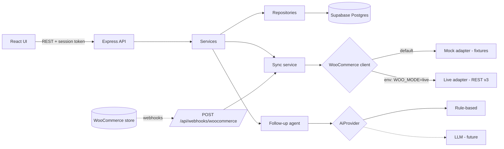
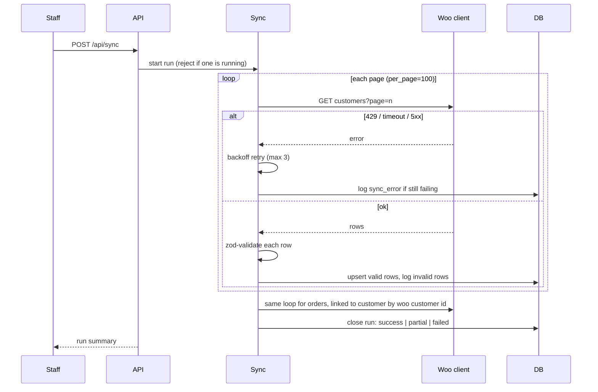
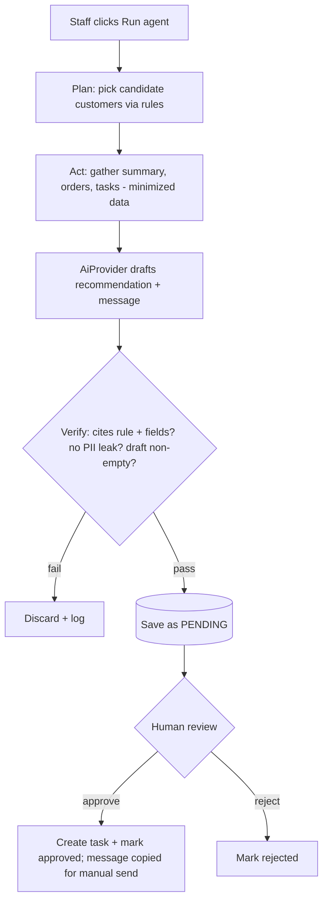

# Architecture & Design (Phase 2 design; Phase 3 implemented; Phase 3b: Express + Supabase Postgres — see §12)

## 1. Technology selection
| Layer | Choice | Why |
|---|---|---|
| Backend | Node.js 22 + Express 4 (+ `helmet`) | Owner's choice; small, well-known |
| Frontend | React + Vite | Owner's choice; fast dev setup |
| Database | **Supabase (hosted Postgres)** via the `pg` driver, `DATABASE_URL` in `.env` | Owner's decision (Phase 3b). Plain SQL + `pg` keeps it portable to any Postgres, incl. a local one for tests |
| Validation | `zod` | One schema per payload; shared error format |
| Unit/integration tests | `vitest` + `supertest` | Fast, one runner for backend and frontend |
| Component tests | React Testing Library | Empty/loading/error states |
| Browser e2e | Playwright spec (run on owner's machine) | Browser download blocked in sandbox (verified) |
| Packaging | Dockerfile + docker-compose | Addresses "deployment" criterion |

## 2. Layering and design patterns
`routes (HTTP, validation) → services (business rules) → repositories (SQL)`; integrations and AI sit behind interfaces.

- **Adapter:** `WooCommerceClient` interface with `MockWooClient` and `LiveWooClient`.
- **Repository:** all SQL isolated; services never build queries.
- **Strategy:** `AiProvider` interface with `RuleBasedProvider` now; `LlmProvider` later.
- **Idempotent consumer:** webhook deliveries and sync upserts keyed by external ID / delivery ID.

## 3. System architecture


## 4. Data model
```mermaid
erDiagram
  CUSTOMERS ||--o{ ORDERS : places
  CUSTOMERS ||--o{ TASKS : has
  CUSTOMERS ||--o{ COMMUNICATIONS : has
  CUSTOMERS ||--o{ RECOMMENDATIONS : receives
  ORDERS ||--o{ ORDER_ITEMS : contains
  SYNC_RUNS ||--o{ SYNC_ERRORS : records
  CUSTOMERS { int id PK; int woo_id UK; text email UK; text first_name; text last_name; text phone; text source; text updated_at }
  ORDERS { int id PK; int woo_id UK; int customer_id FK; text status; real total; text currency; text placed_at; text synced_at }
  ORDER_ITEMS { int id PK; int order_id FK; text name; int qty; real price }
  TASKS { int id PK; int customer_id FK; text title; text due_date; text status }
  COMMUNICATIONS { int id PK; int customer_id FK; text channel; text body; text direction; text created_at }
  RECOMMENDATIONS { int id PK; int customer_id FK; text rule_id; text evidence_json; text draft; text status; text decided_at }
  SYNC_RUNS { int id PK; text mode; text status; int customers; int orders; text started_at; text finished_at }
  SYNC_ERRORS { int id PK; int run_id FK; text entity; text external_id; text message; int retryable }
  WEBHOOK_EVENTS { text delivery_id PK; text topic; text received_at }
  SEGMENT_RULES { int id PK; text name; text rule_json }
```
Duplicate prevention: `UNIQUE(woo_id)` plus `UNIQUE(lower(email))`; upsert on conflict.

## 5. Synchronization flow

Retry endpoint re-runs only failed entities; upserts make it safe.

## 6. API inventory
| Method | Path | Purpose | Auth |
|---|---|---|---|
| POST | /api/auth/login | Staff login (token) | public |
| GET/POST | /api/customers | List+search (`q`, `segment`, paging) / create | staff |
| GET/PUT | /api/customers/:id | Detail with order summary / edit | staff |
| GET | /api/customers/:id/orders | Order history | staff |
| GET/POST | /api/customers/:id/tasks, /communications | Follow-ups, notes | staff |
| GET | /api/dashboard | Aggregates | staff |
| GET/PUT | /api/segments | View/configure rules | staff |
| POST | /api/sync | Run sync | staff |
| POST | /api/sync/retry | Retry failed items | staff |
| GET | /api/sync/status, /api/sync/errors | Diagnostics, mode label | staff |
| POST | /api/webhooks/woocommerce | Signed webhook | HMAC |
| POST | /api/agent/run | Generate recommendations | staff |
| GET | /api/recommendations | Pending list | staff |
| POST | /api/recommendations/:id/approve, /reject | Human decision | staff |

## 7. Integration security plan
- Keys in `.env` only (`WOO_URL`, `WOO_CONSUMER_KEY`, `WOO_CONSUMER_SECRET`, `WOO_WEBHOOK_SECRET`, `WOO_MODE`, `SESSION_SECRET`); `.env` git-ignored; `.env.example` committed.
- Credentials never sent to the browser or AI provider; log sanitizer redacts keys/emails.
- Webhook: HMAC-SHA256 over raw body, `crypto.timingSafeEqual`, then dedupe by `X-WC-Webhook-ID`.
- Live client: HTTPS required, 10 s timeout, bounded retries.
- Basic security headers (`helmet`), rate limit on login, parameterized SQL only.

## 8. Agentic AI workflow
**Goal:** surface customers needing follow-up and prepare a justified draft for staff.
**Permitted tools (read-only except draft storage):** `getCustomerSummary`, `getOrders`, `getOpenTasks`, `evaluateRules`, `saveRecommendation` (status = pending).
**Forbidden:** sending messages, editing customers/orders, creating tasks without approval, reading credentials.
**Decision boundaries:** only rule-triggered customers; each recommendation must cite rule id + data fields; confidence is rule-based, not invented.

Even on approval the system does **not** send email; it creates a task and a ready-to-send draft (no email infrastructure, safer).

## 9. Implementation roadmap
| Phase | Output | Exit check |
|---|---|---|
| 3 | Scaffold, migrations, CRM API + UI, unit tests | `npm test` green; list/search/detail work |
| 4 | Mock + live adapters, sync, webhook | Integration tests for dupes, 429, timeout, retry |
| 5 | Agent + approval UI | Agent tests incl. approval gate |
| 6 | E2E, security checks, error states | Full suite run; failures documented |
| 7 | README, setup docs, test report | Fresh-clone install tested in sandbox |
| 8 | Demo script, scorecard | Owner records video |

## 10. Risk register
See `docs/requirements.md` §8 (R1–R7).

## 12. Phase 3 / 3b implementation notes and deviations
Phase 3 was first built on `node:http` + `node:sqlite` because the sandbox has no npm network. The owner then chose **Express** and **Supabase**, and the code was ported (Phase 3b).

| Topic | Decision | Consequence |
|---|---|---|
| Express | `server/app.js` adapts the framework-agnostic route table (`server/http/routes.js`) to Express: `helmet`, `express.json({limit:'1mb'})`, per-pattern 405, JSON 404 under `/api`, one error middleware, static + SPA fallback | Route handlers contain no Express types. **Written, not run** (Express not installable here). |
| Supabase | `pg` pool from `DATABASE_URL`; `DB_SSL=require` (+ optional `DB_SSL_CA` to verify the server certificate) | Connection string only in `.env` (git-ignored). **Not connected** to any Supabase project from here. |
| Row level security | Every table has `ENABLE ROW LEVEL SECURITY` and **no policies** | Supabase exposes the `public` schema over its REST API; with RLS and no policies the anon/authenticated roles get nothing. Only our server's direct connection (privileged role) works. Unit test checks every `CREATE TABLE` has RLS. |
| Types | `NUMERIC`/`BIGINT` parsed to JS numbers, `DATE` kept as `YYYY-MM-DD` string, timestamps as `timestamptz` | Set in `server/pool.js`; asserted by a DB-backed test. |
| Transactions | `db.tx(fn)`; nested calls use savepoints; migrations take an advisory lock | Unit-tested against a fake pool (statement sequence). |
| Duplicate emails | Friendly pre-check plus unique index on `lower(email)`; SQLSTATE `23505` is mapped to 409 | Covers the race the pre-check cannot. |
| Query parameters | Repeated keys (`?q=a&q=b`) are a 400 | Express parses them into arrays; found while porting. |
| Tests | Unit tests need nothing. DB-backed tests use `TEST_DATABASE_URL` and an isolated random schema per run (dropped afterwards); without it they are **skipped**, never silently passed | Do not point it at production. |
| Auth | **Not yet implemented** (Phase 6) | The API is open; run on localhost only. |
| `PATCH /api/tasks/:id` | Added | Needed to complete a follow-up; not in §6. |
| Vite | Source is Vite-ready; `npm run web:build` not run here (verified with an esbuild bundle in Phase 3) | |

Data-model dialect: §4 shows logical types; the SQL in `server/migrations/001_core.sql` is Postgres (`bigint identity`, `numeric(12,2)`, `timestamptz`, `date`). Migration 001 covers Phase 3 tables only; sync, webhook, segment and recommendation tables arrive in later numbered migrations.
